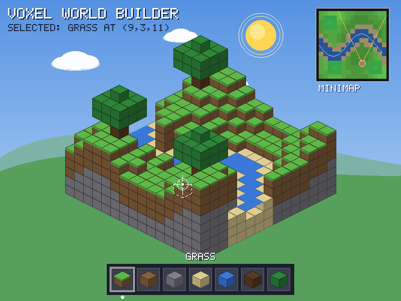
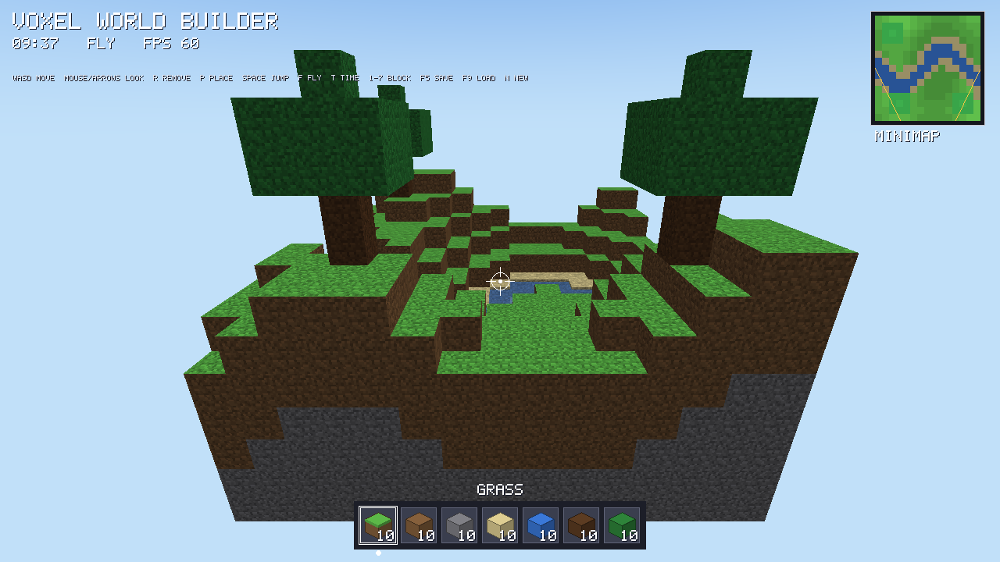
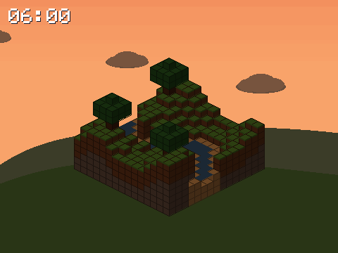
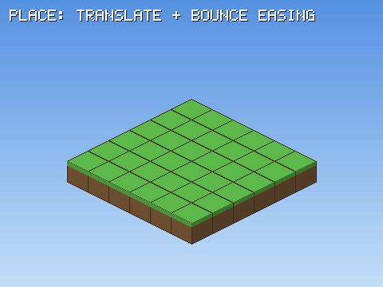
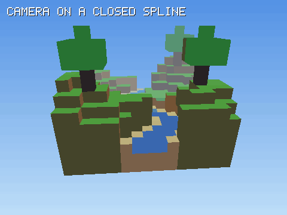
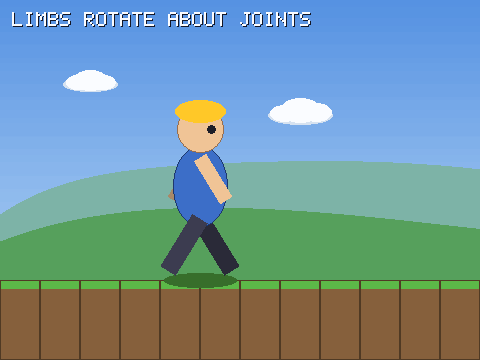

# Voxel World Builder

A lightweight voxel sandbox: the player explores a small floating island, looks around with a crosshair, and **places or removes blocks** (grass, dirt, stone, sand, water, wood, leaves) chosen from a hotbar, while the sun moves through a full day/night cycle.

The project is built up in checkpoints:
- **CP1, technical foundation (pure C++):** every algorithm covered in class, implemented from scratch with no graphics library and applied to a game component.
- **CP2, transformation and animation (pure C++):** 2D and 3D matrix transformations, keyframe animation with easing, and a day/night cycle, rendered frame by frame.
- **CP3, OpenGL prototype:** an interactive first-person game that reuses the CP1 algorithms (for its HUD) and the CP2 maths and animation (for its matrices, lighting and block animations).

| CP1: visual concept (pure C++) | CP3: OpenGL prototype |
|---|---|
|  |  |

| CP2: day/night | CP2: placing blocks | CP2: camera fly-through | CP2: walk cycle |
|---|---|---|---|
|  |  |  |  |

---

## 1. Problem / need
Building and editing 3D worlds is usually done in large engines that hide how pixels are actually produced. Students and beginners need a **small, readable** example where every line, polygon, curve and colour is drawn by code they can follow. Voxel worlds are ideal for this: they are built from simple, repeated shapes (cubes made of polygons), but they still exercise every stage of the pipeline: rasterisation, filling, clipping, colour, transformation, animation and finally GPU rendering.

## 2. Target users
- **Casual players and children** who enjoy creative building games and want something simple and fast.
- **Computer graphics students** who want to see classic algorithms (Bresenham, midpoint circle, scanline fill, Sutherland–Hodgman, Bézier, homogeneous transforms) running in a real application.
- **Teachers** who need visual, step-by-step examples of these algorithms.

## 3. Project scope
| In scope | Out of scope |
|---|---|
| Small fixed-size world (15 × 13 × 15 blocks) with generated terrain, river and trees | Infinite worlds, chunk streaming |
| 7 block types, place/remove blocks, hotbar selection, save/load | Crafting, inventory, survival, mobs |
| Isometric (pure C++) and first-person (OpenGL) views | Multiplayer, networking |
| UI: crosshair, hotbar, selection outline, minimap, clock | Sound |
| Day/night cycle, block animations, walking with gravity and collision, fly mode | Advanced physics, fluids |

## 4. Components
| Component | Built from |
|---|---|
| Voxel block | 3 face polygons, scanline fill, HSV shading, line outlines (CP1); cube mesh with normals (CP3) |
| Terrain and world | Painter's algorithm, hidden-face culling, polygon clipping (CP1); GPU mesh (CP3) |
| Hills and skyline | Bézier curves filled as polygons (CP1); parallax scrolling (CP2) |
| River, camera path | Catmull–Rom spline, B-spline (CP1); closed spline camera path (CP2) |
| Sun, moon, clouds, stars | Midpoint circle and ellipse (CP1); rotation about a pivot, keyframed colours (CP2); sky shader (CP3) |
| Builder character | Circles and ellipses (CP1); limbs rotated about joints (CP2) |
| Crosshair, hotbar, minimap | Midpoint circle, Bresenham lines, BitBlt with colour key, Cohen–Sutherland clipping (CP1); shown in OpenGL as a texture (CP3) |
| Selection | Dashed Bresenham outline (CP1); voxel ray cast + wireframe box (CP3) |
| Placing / removing | Easing + translate / scale / rotate (CP2); same animation in OpenGL with `Mat4` (CP3) |

## 5. Graphics techniques / algorithms implemented
### Checkpoint 1 (pure C++)
| Topic | Algorithm(s) | Code | Output |
|---|---|---|---|
| Line drawing | DDA, Bresenham (integer decision parameter, all octants), thick and dashed lines | [Lines.cpp](src/raster/Lines.cpp) | `01_lines` |
| Line operations | Cohen–Sutherland clipping (outcodes) | [Lines.cpp](src/raster/Lines.cpp) | `02_line_clipping` |
| Circles and ellipses | Midpoint circle (8-way symmetry), midpoint ellipse (two regions), filled versions | [Circles.h](src/raster/Circles.h) | `03_circles_ellipses` |
| Polygon representation | Vertex lists, shoelace area, centroid, convexity test, point-in-polygon | [Polygons.cpp](src/raster/Polygons.cpp) | `04_polygon_fill` |
| Polygon filling | Scanline fill with Edge Table / Active Edge Table, boundary fill, flood fill | [Polygons.cpp](src/raster/Polygons.cpp) | `04_polygon_fill` |
| Polygon clipping | Sutherland–Hodgman (shown edge by edge) | [Polygons.cpp](src/raster/Polygons.cpp) | `05_polygon_clipping` |
| Curves | Bézier (de Casteljau and Bernstein form), Catmull–Rom spline, uniform cubic B-spline | [Curves.cpp](src/raster/Curves.cpp) | `06_curves` |
| Colour theory | RGB ↔ HSV, shading by HSV value, additive (RGB) and subtractive (CMY) mixing | [ColorOps.cpp](src/color/ColorOps.cpp) | `07_colour_theory` |
| Colour space reduction | Greyscale, uniform and popularity palettes, quantisation, ordered and Floyd–Steinberg dithering | [ColorOps.cpp](src/color/ColorOps.cpp) | `08_colour_reduction` |
| Raster operations | REPLACE / XOR / AND / OR, BitBlt, colour-key transparency, sprite masking, bitmap font | [Canvas.cpp](src/core/Canvas.cpp), [Font.cpp](src/core/Font.cpp) | `09_raster_ops` |
| Pipeline preview | Isometric and perspective projection, z-buffer, back/hidden-face culling | [Voxel.cpp](src/scene/Voxel.cpp), [Preview3D.cpp](src/scene/Preview3D.cpp) | `10`, `11` |

### Checkpoint 2 (pure C++)
| Topic | Algorithm(s) | Code | Output |
|---|---|---|---|
| 2D transformations | 3×3 homogeneous matrices: translate, rotate, scale, shear, reflect; rotate/scale/reflect about a fixed point; composite order (T·R ≠ R·T) | [Transform.cpp](src/math/Transform.cpp) | `12_transform_2d` |
| 3D transformations | 4×4 matrices: translate, rotate X/Y/Z, scale, composites about the cube centre | [Transform.cpp](src/math/Transform.cpp) | `13_transform_3d` |
| Viewing pipeline | Look-at view matrix, perspective projection, near-plane clipping in clip space, perspective divide, viewport, z-buffer, flat shading, fog | [Renderer3D.cpp](src/scene/Renderer3D.cpp) | `13`, `16` |
| Keyframe animation | Keyframe tracks with tweening for numbers, points and colours | [Animation.h](src/anim/Animation.h) | `14` |
| Easing | Linear, quadratic, cubic, back (overshoot), bounce | [Animation.cpp](src/anim/Animation.cpp) | `15` |
| Day/night cycle | Keyframed sky and light colours; sun and moon rotate about a pivot; stars fade | [Animation.cpp](src/anim/Animation.cpp) | `14_anim_day_night` |
| Motion along a path | Camera on a closed Catmull–Rom spline | [AnimationDemos.cpp](src/demos/AnimationDemos.cpp) | `16_anim_flythrough` |
| Hierarchical motion | Walk cycle: limbs rotate about hip and shoulder joints, body bob, parallax scrolling | [AnimationDemos.cpp](src/demos/AnimationDemos.cpp) | `17_anim_walk` |

### Checkpoint 3 (OpenGL 3.3)
| Feature | How | Code |
|---|---|---|
| World rendering | Whole world built into one vertex buffer with hidden-face culling, rebuilt on every edit; GL back-face culling | [WorldMesh.cpp](src/engine/WorldMesh.cpp) |
| Shading | Lambert diffuse + ambient from the day/night cycle, texture detail tinted by block colour, distance fog | [engine.cpp](src/apps/engine.cpp) |
| Transparency | Water drawn last with alpha blending and no depth writes | [engine.cpp](src/apps/engine.cpp) |
| Sky | Full-screen shader: un-projects each pixel with the inverse view-projection matrix; gradient, sun, moon, stars | [engine.cpp](src/apps/engine.cpp) |
| Matrices | Our own `Mat4` (CP2), uploaded with `transpose = GL_TRUE`; no GLM | [GlUtil.cpp](src/engine/GlUtil.cpp) |
| Picking | Amanatides–Woo voxel traversal: exact block and face under the crosshair | [Raycast.cpp](src/engine/Raycast.cpp) |
| Player | Mouse look, walking with gravity, jumping, per-axis collision, fly mode | [Player.cpp](src/engine/Player.cpp) |
| HUD | Drawn by the CP1 raster code into a `Canvas`, uploaded as a texture, magenta = transparent | [HudOverlay.cpp](src/engine/HudOverlay.cpp), [Hud.cpp](src/ui/Hud.cpp) |
| Block animation | Placed blocks pop in (`outBack` easing); removed blocks spin and shrink: `T · R · S` model matrix | [engine.cpp](src/apps/engine.cpp) |
| Save / load | Binary world file | [Voxel.cpp](src/scene/Voxel.cpp) |

Screenshots are in [outputs/cp1/png/](outputs/cp1/png/), [outputs/cp2/png/](outputs/cp2/png/), [outputs/cp2/gif/](outputs/cp2/gif/) and [outputs/cp3/png/](outputs/cp3/png/), and are collected in [docs/CP1_Evidence.pdf](docs/CP1_Evidence.pdf), [docs/CP2_Evidence.pdf](docs/CP2_Evidence.pdf) and [docs/CP3_Evidence.pdf](docs/CP3_Evidence.pdf).

## 6. Visual concept
A bright, blocky, "toy-like" look: a floating island under a gradient sky with a sun, soft clouds and Bézier hills; a hotbar at the bottom; a minimap in the corner; an outline and crosshair on the selected block. Colours come from a small fixed palette; each block's faces are the same hue at different brightness levels (HSV value), which gives a consistent light direction. The day/night cycle shifts the whole palette from warm sunrise, through blue day and orange sunset, to a dark starry night.

## 7. Plan
| Checkpoint | Week | Deliverable | Status |
|---|---|---|---|
| CP1: Technical foundation | 8 | All CP1 algorithms in pure C++, applied to game components; visual concept | **Done** |
| CP2: Transformation and animation | 10 | 2D/3D matrices, viewing pipeline, keyframes and easing, 4 animations | **Done** |
| CP3: OpenGL integration + prototype | 12 | Playable OpenGL prototype that reuses CP1 + CP2 code | **Done** |
| Final project | 13 | Polish: per-block textures (texture atlas), sounds, more block types, menus, final report and demo video | Planned |

## 8. Group members and responsibilities
| Member | Responsibilities | Main files |
|---|---|---|
| **Mary Queenvine Muthoni** | Line drawing (DDA, Bresenham, line styles), Cohen–Sutherland clipping, circles and ellipses; OpenGL prototype: window, input, camera, shaders, textures | `src/raster/Lines.*`, `src/raster/Circles.*`, `src/apps/engine.cpp`, `src/engine/Player.*` |
| **Emmanuel Keter** | Framebuffer and raster operations, polygon filling and clipping, voxel world data structures, HUD, world mesh and picking, project integration | `src/core/*`, `src/raster/Polygons.*`, `src/scene/Voxel.*`, `src/ui/*`, `src/engine/WorldMesh.*`, `src/engine/Raycast.*`, `src/engine/HudOverlay.*`, `src/demos/*` |
| **Louis Karanja** | Maths and coordinate systems: 2D/3D transformation matrices, projection, software 3D renderer; Bézier curves and splines; colour theory and reduction; animation and day/night cycle | `src/math/*`, `src/anim/*`, `src/scene/Renderer3D.*`, `src/raster/Curves.*`, `src/color/*` |

## 9. Technologies and tools
- **Language:** C++17
- **Compiler / build:** GCC (g++) with `make`; tested with g++ 13 on Ubuntu (WSL)
- **CP1/CP2 output:** binary PPM (`P6`), written by our own code
- **CP3:** OpenGL 3.3 core, GLFW (window and input), GLEW (extension loading), [stb_image](third_party/stb_image.h) (PNG loading). All matrix maths is our own.
- **Evidence tooling:** Python + Pillow (PPM → PNG/GIF/PDF only); Xvfb for headless engine screenshots
- **Version control:** Git and GitHub

## 10. Project structure
```
src/
  core/      Canvas (framebuffer, raster ops, PPM output), bitmap font, 2D geometry types
  raster/    Lines, Circles, Polygons, Curves                    <- CP1 algorithms
  color/     HSV, palettes, quantisation, dithering              <- CP1
  math/      Mat3 / Mat4 transformations, projection             <- CP2
  anim/      Easing, keyframe tracks, day/night cycle            <- CP2
  scene/     Voxel world, isometric blocks, software 3D renderer
  ui/        HUD: crosshair, hotbar, minimap (shared by all programs)
  demos/     One function per output image / animation
  engine/    OpenGL helpers, world mesh, ray casting, player, HUD overlay   <- CP3
  apps/      renderer.cpp (CP1), animator.cpp (CP2), engine.cpp (CP3)
assets/      texture.png (16x16 block detail texture)
third_party/ stb_image.h
outputs/     cp1/, cp2/, cp3/ screenshots (png/, gif/); phase*.ppm = earliest prototype renders
tools/       make_evidence.py, cp3_screenshots.sh
docs/        CP1/CP2/CP3 evidence PDFs
```

## 11. How to compile and run

### Getting started from a fresh clone

#### Windows laptop (using WSL)
**1. Install WSL** (once). Open PowerShell **as Administrator**:
```powershell
wsl --install -d Ubuntu
```
Restart when asked, then open **Ubuntu** from the Start menu and create a username and password.

**2. Install the tools** (once), in the Ubuntu terminal:
```bash
sudo apt update
sudo apt install -y git g++ make libglfw3-dev libglew-dev
```

**3. Clone the project:**
```bash
cd ~
git clone https://github.com/Queenvinemuthoni/CompGraphics.git
cd CompGraphics
```

**4. Run it:**
```bash
make play       # the OpenGL game (CP3)
make run        # CP1 images  -> outputs/cp1/
make animate    # CP2 images + animation frames -> outputs/cp2/
```
To open the output folder in Windows Explorer, type `explorer.exe .` in the Ubuntu terminal. Ready-made PNGs, GIFs and PDFs are already in the repository under `outputs/*/png`, `outputs/cp2/gif` and `docs/`.

#### Linux laptop (Ubuntu or Debian)
Follow steps 2–4 above (no WSL needed).

#### Mac
Not supported yet: macOS needs small changes to the OpenGL window setup and the Makefile.

#### Troubleshooting
| Problem | Fix |
|---|---|
| `make: command not found` or `g++: not found` | Step 2 was skipped |
| `GL/glew.h: No such file` | `sudo apt install libglew-dev libglfw3-dev` |
| "Failed to create window" | In PowerShell: `wsl --update`, then `wsl --shutdown`, and reopen Ubuntu (needs Windows 11, or Windows 10 build 19044 or later) |
| Game runs slowly | WSL is drawing without the graphics card; updating the GPU driver on Windows usually helps |
| Blocks have plain colours (no texture) | Run `make play` from the project folder, not from inside `bin/` |

### All commands
Run from the project root:

| What | Command | Output |
|---|---|---|
| CP1 technique demos | `make run` | `outputs/cp1/*.ppm` |
| CP2 transformations + animations | `make animate` | `outputs/cp2/*.ppm` and `outputs/cp2/frames/` |
| CP3 play the game | `make play` | opens a 1280×720 window |
| Convert to PNG/GIF/PDF | `python tools/make_evidence.py` | `outputs/*/png`, `outputs/cp2/gif`, `docs/*.pdf` |
| CP3 screenshots (headless) | `sh tools/cp3_screenshots.sh` (needs `xvfb`) | `outputs/cp3/*.ppm` |

**Game controls:**
| Key / mouse | Action |
|---|---|
| W A S D | Move |
| Mouse or arrow keys | Look around (Left/Right turn, Up/Down tilt) |
| Space | Jump (walk mode) / up (fly mode) |
| Left Shift | Down (fly mode) |
| F | Toggle walk / fly |
| Left click / right click | Remove / place block |
| 1–7 or mouse wheel | Choose block type |
| T (hold) | Speed up time |
| F5 / F9 | Save / load the world (`world.vxw`) |
| R | Generate a fresh world |
| Esc | Quit |

The engine also accepts `--time 0.5 --pos X Y Z --look YAW PITCH --fly --slot N --screenshot FILE.ppm` to start at a given place and time or save a screenshot.

## 12. Current progress
- **CP1:** all topics implemented in pure C++; 11 labelled images.
- **CP2:** transformation module (`Mat3`, `Mat4`), a complete software viewing pipeline, an animation module with easing, keyframes and a day/night cycle, 2 transformation pages and 4 animations (340 frames, plus GIFs).
- **CP3:** playable OpenGL prototype:
  - same world, colours and HUD code as the pure C++ programs, and our own matrices
  - day/night lighting, sky with sun, moon and stars, transparent water and fog
  - exact block picking, walking with collision, fly mode, animated placing/removing, save/load
- Bugs fixed along the way:
  - the original 3D prototype positioned blocks after rotation and had a flipped Y axis
  - the texture file was WebP with a `.png` name, so it never loaded; it is now a real PNG
  - block picking stepped along the ray in fixed increments and could miss blocks; it now uses an exact grid traversal

## 13. Known limitations and issues
- The world size is fixed (15 × 13 × 15). The whole mesh is rebuilt on every edit, which is fast at this size but would need chunking for large worlds.
- One detail texture is tinted per block type, not a separate texture per block.
- The isometric renderer's painter's algorithm (sorted by `x + y + z`) is only correct for unit cubes on a grid.
- The pure C++ 3D renderer uses flat shading and clips only against the near plane; triangles outside the screen are discarded per pixel.
- The OpenGL prototype needs OpenGL 3.3. Under WSL it needs WSLg (Windows 11) to open a window.
- Collision uses the player's bounding box against whole blocks, so there are no slopes or half blocks. Water does not flow.
- PPM output cannot be previewed on Windows directly; use the PNG copies.
